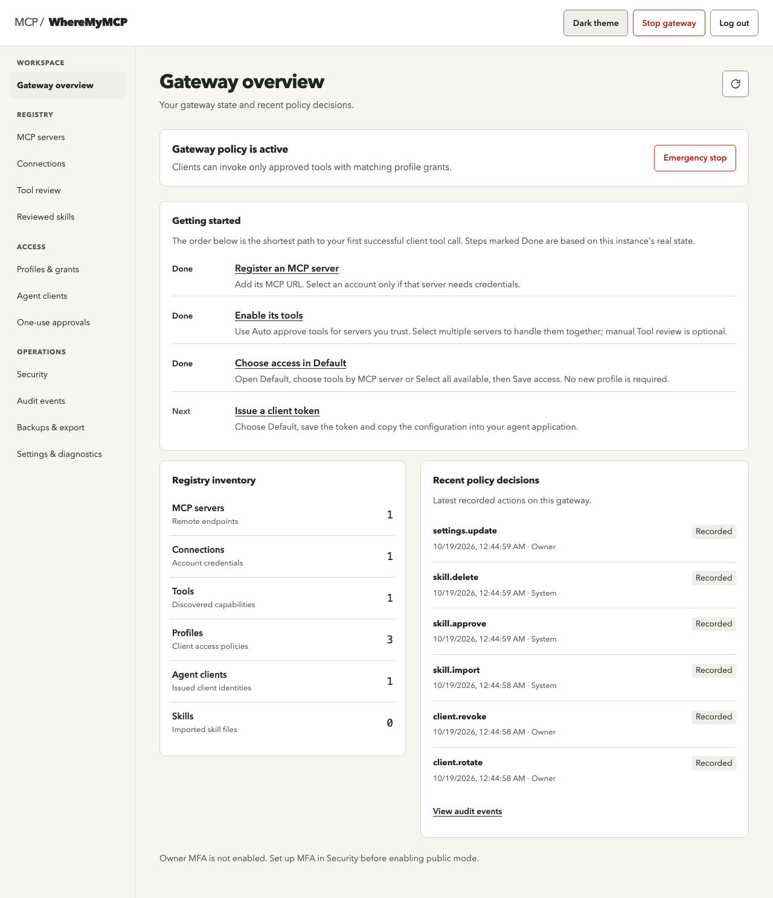
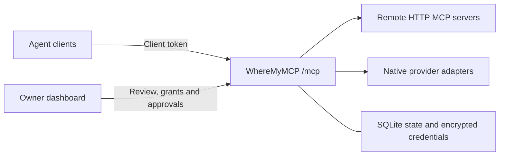

# WhereMyMCP

A self-hosted MCP gateway for your tools, accounts and agent clients.

Connect remote MCP servers, approve trusted servers in bulk, and choose what each agent can use. WhereMyMCP keeps provider credentials on your instance and issues separate, revocable tokens for your clients. One owner manages access through the dashboard.

Development release. Review the [current limitations](#current-limitations) before deployment.



*Dashboard preview from an isolated test instance.*

[Quick start](#quick-start) · [Connect an agent](#connect-an-agent) · [Documentation](#documentation) · [Development](#development)

## Features

| Capability | What you control |
| --- | --- |
| MCP gateway | Register remote Streamable HTTP servers and discover their tools through one `/mcp` endpoint. |
| Tool approval | Auto approve current tools from selected trusted servers in bulk, or review individually. Metadata changes quarantine affected tools until explicitly approved again. |
| Profiles and clients | Select whole MCP servers or all available tools for a profile. Exact tools and account bindings stay enforced. Issue, rotate, expire or revoke client tokens. |
| Multiple accounts | Keep account connections under distinct aliases and stable IDs, with encrypted provider credentials. |
| One-use approvals | Authorize each write or delete call for one client, one tool and one exact argument object. |
| Management MCP | Optionally enable Read/Write/Delete administration on a client token. The same `/mcp` connection serves provider and management tools. |
| Owner dashboard | Manage connections, servers, grants, clients, skills, MFA, audit events and backups. |
| Backup and portability | Create and download encrypted backups, restore offline, and preview credential-free configuration imports. |
| Reviewed skills | Preview imported files, approve them, and explicitly plan/apply file sync through the CLI. |

Bulk approval uses explicit `destructiveHint: true` for Delete, `readOnlyHint: true` for Read, and Write when hints are missing or unclear. Server metadata is trusted only after owner confirmation. Write/delete calls still require one-use approval; future metadata changes still quarantine tools. Bulk approval does not create profile grants.

New profiles grant no access by default. The owner signs in with a dashboard session; agents use profile-bound bearer tokens. Upstream requests use the credentials bound to the approved tool, rather than the agent's gateway token.

## How it works



## Quick start

### 1. Start the instance

Install Docker Engine with Docker Compose. From the repository root:

```sh
docker compose build init
docker compose up -d
docker compose ps
curl --fail http://127.0.0.1:8080/health/ready
```

The `init` service builds the shared image and prepares persistent state and secret volumes. The `hub` service starts after initialization. Port 8080 binds to `127.0.0.1` by default.

### 2. Claim the owner account

Open **[http://127.0.0.1:8080](http://127.0.0.1:8080)**. Read the one-time setup token in your terminal:

```sh
docker compose exec hub cat /secrets/bootstrap.token
```

Enter the token within 30 minutes and create the owner account. Passwords require at least eight characters, including lowercase, uppercase, a number and a symbol. Save the recovery codes when they appear; they are shown once.

Log in and enable authenticator MFA under **Security**. Owner claim closes bootstrap setup. For an expired setup token or a source installation, follow the [installation guide](docs/install/README.md).

### 3. Configure your first client

1. In **Connections**, add the credentials required by your server. An unauthenticated server can use no connection.
2. In **MCP servers**, register the remote endpoint and select its connection if needed.
3. In **MCP servers**, select the servers you trust and choose **Auto approve selected servers**. Confirm server trust. The batch refreshes discovery and enables current tools using their annotations. Manual **Tool review** remains available for individual overrides.
4. In **Profiles & grants**, open **Default → Edit tool access**. Select entire MCP servers or **Select all available**, then **Save access**. A new profile is optional.
5. In **Agent clients**, issue a token bound to that profile. Save it when it appears.
6. Generate the client configuration, set the token in the client's environment and connect to `/mcp`.

Write and delete calls also require approval through **One-use approvals**. Pass the returned approval ID as `_meta.wheremymcp_approval_id` on the tool call. See [gateway compatibility](docs/compatibility/gateway.md) for protocol details and limits.

## Connect an agent

The default gateway endpoint is `http://127.0.0.1:8080/mcp`.

For Codex, add this to `~/.codex/config.toml`:

```toml
[mcp_servers.wheremymcp]
url = "http://127.0.0.1:8080/mcp"
bearer_token_env_var = "WHEREMYMCP_TOKEN"
```

Set `WHEREMYMCP_TOKEN` in the environment used to launch the client, using the token shown at creation or rotation. Keep the credential out of committed configuration files.

The dashboard also generates configurations for Claude Code, Cursor and Gemini, plus transport guidance for Hermes and other clients. Installed client versions still need their own compatibility check; config generation alone does not prove interoperability. The [compatibility report](docs/compatibility/gateway.md) records the official SDK transports exercised locally.

## Manage WhereMyMCP through MCP

Keep the same `/mcp` URL and client token used for provider tools. In **Agent clients**, choose **Edit management access** on the client you want to authorize, or select management access while issuing a client token. Management starts off. Choose Read for inspection, Read + Write for configuration changes, or Read + Write + Delete for full management. Confirm your owner password and authenticator code when MFA is enabled.

```toml
[mcp_servers.wheremymcp]
url = "http://127.0.0.1:8080/mcp"
bearer_token_env_var = "WHEREMYMCP_TOKEN"
```

Existing client configuration needs no new token, URL or second MCP entry when you enable management access. Reload the client's MCP connection to refresh its tools. **Client config** generates Codex, Claude, Cursor and Gemini formats, plus Hermes/other transport guidance. Provider tools remain controlled by the client's profile; built-in `wheremymcp_manage_*` tools follow its management permissions.

Example request: “Register this MCP server, approve its current tools, and give Default access to that server.” Management Write can issue ordinary agent tokens and change access; treat it as configuration administration. Only the owner can grant management access or rotate a management-enabled client token. Provider consent and owner security stay in the dashboard. Earlier separate `/mcp/manage` connections remain compatible. See [Management MCP](docs/management-mcp.md) for scopes, tools and migration.

## Connections and integrations

- Remote MCP endpoints can use bearer-token, API-key or remote OAuth connections.
- Native GitHub tools cover repositories, issues, file reads, issue creation and comments.
- Native Google tools cover Calendar and Drive operations within the configured app's granted scopes.
- Native Slack tools cover conversations, channel history and messages within the configured app's permissions.

OAuth integrations use your own provider app configuration. Consent, app verification, provider scopes and quotas still apply. See [Connections and integrations](docs/integrations.md). Live provider consent has not been verified by the local fixture tests.

## Security and operations

Owner authentication uses Argon2id, optional TOTP MFA and one-use recovery codes. Browser mutations require CSRF protection. Stored client tokens are hashed; provider credentials and backups use authenticated encryption.

Every tool call checks current access policy, connection state, tool approval and metadata fingerprint. Audit events record decisions and timing without tool arguments, results or credentials. The gateway rejects redirects and blocks private and metadata destinations by default; intentional local connections require exact IP exceptions. No telemetry is sent.

Run one owner, one database and one application replica per instance. Retain the external master key separately from state and encrypted backups. Losing that key prevents credential and backup recovery. Follow the [backup, restore and key rotation guide](docs/install/backup-restore.md), including a restore into a fresh destination.

Public mode requires an exact HTTPS origin, explicitly trusted proxy IPs and owner MFA. Read the [public deployment guide](docs/security/public-deployment.md) before exposing the service. Local tests do not replace an independent security review. Vulnerability reporting follows [SECURITY.md](SECURITY.md).

### Updating an initialized Docker instance

Check out the revision you intend to run and retain a backup plus the external master key. Then:

```sh
docker compose build init
docker compose up -d --no-deps --wait --wait-timeout 30 hub
curl --fail http://127.0.0.1:8080/health/ready
```

Both services use the image built by `init`. `--no-deps` replaces the application without rerunning initialization against an active database. Named volumes retain state and secrets.

`docker compose down` retains named volumes. Adding `-v` deletes them, including the database and master key.

Existing installations created under the former UnifyMCP name must retain their Compose project and volumes. See [rename compatibility](docs/rename-compatibility.md) before changing deployment identifiers. Existing client tokens and encrypted backups remain supported.

## Current limitations

- Single owner and single replica. There is no multi-tenant or hosted control plane.
- MCP tools use Streamable HTTP. Resources, prompts, legacy HTTP+SSE transport and resumable sessions are not implemented.
- Local stdio execution and shell hooks are disabled. Imported skill content is not executed.
- Skill publisher trust metadata and client-specific installation adapters are not implemented. Sync uses CLI preview and apply steps.
- The dashboard lists backups but does not track successful restore drills.
- Native client applications, live OAuth consent, physical mobile devices, screen readers and Kubernetes runtime need separate verification.

## Documentation

| Guide | Contents |
| --- | --- |
| [Installation](docs/install/README.md) | Docker, source setup, bootstrap recovery and deployment configuration. |
| [Integrations](docs/integrations.md) | Remote MCP authentication and provider setup. |
| [Dashboard](docs/dashboard.md) | Owner workflows, client configuration and UI behavior. |
| [Management MCP](docs/management-mcp.md) | Unified client-token setup, optional management scopes and security boundaries. |
| [Gateway compatibility](docs/compatibility/gateway.md) | Transports, authorization, approvals and resource limits. |
| [Backup and restore](docs/install/backup-restore.md) | Encrypted backups, offline restore and key rotation. |
| [Public deployment](docs/security/public-deployment.md) | HTTPS proxy, MFA and network boundaries. |
| [API contracts](docs/contracts.md) | Routes, data model and response conventions. |
| [Rename compatibility](docs/rename-compatibility.md) | Existing volumes, tokens, encryption and approval metadata. |

## Development

WhereMyMCP uses TypeScript, Fastify, SQLite WAL and a browser UI built with native JavaScript and CSS. Node.js 22.19.0+ and npm are required. Native SQLite and Argon2 dependencies may need a compiler toolchain when prebuilt binaries are unavailable.

```sh
npm ci
npx playwright install chromium
npm test
npm run typecheck
npm run build
npm run cli -- --help
```

On Linux, Chromium may also need system dependencies; CI uses `npx playwright install --with-deps chromium`. For running from source, configure the data directory and external master-key path using the [installation guide](docs/install/README.md).

```text
src/            API, authentication, vault, providers and CLI
src/gateway/    MCP transport, discovery and call policy
public/         Owner dashboard
tests/          Unit, integration, browser and container checks
deploy/         Container initialization, proxy example and Helm chart
docs/           Installation, integrations and API guides
```

Tests cover browser workflows, SDK calls, backup/restore, migrations and OAuth failure paths. Live provider consent and installed-client compatibility require their own checks.

Follow [CONTRIBUTING.md](CONTRIBUTING.md) for changes. See [CHANGELOG.md](CHANGELOG.md) for repository history.

## License

Licensed under the [MIT License](LICENSE), copyright 2026 Rizki Darmawan. Package metadata retains `private: true` to prevent accidental npm publication. The setup instructions build from source and do not assume a published image or package.
